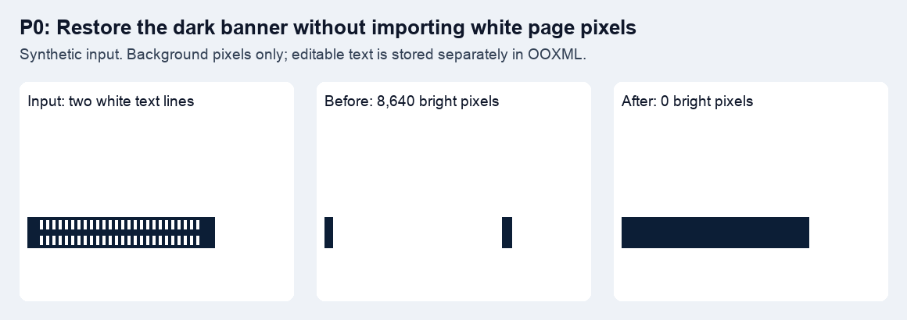
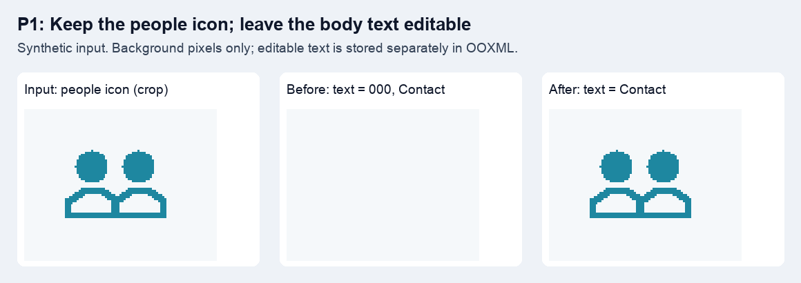
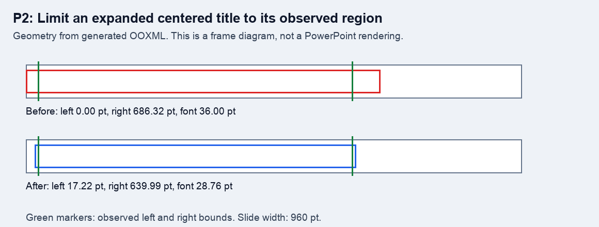

# 品質改善の PR 比較資料

2026-10-27 に合成入力を各コミットの `n2p-build` へ渡して取得した結果。
比較用の入力は、このリポジトリの回帰テストを基に作成した。
提供資料、実資料の画像、フォントファイルは含めていない。

| 段階 | 修正前 | 修正後 | 比較内容 |
| --- | --- | --- | --- |
| P0 | `dc8230b` | `016470e` | 暗色帯の文字消去後の背景 |
| P1 | `016470e` | `505b5f3` | 人物アイコンの背景画素と OOXML の文字一覧 |
| P2 | `505b5f3` | `17a73b5` | 中央揃え文字枠の座標と出力文字サイズ |

## P0: 背景補間



左は入力、中央と右は編集可能な文字を重ねる前の背景。
暗色帯の評価領域 `(0, 120, 240, 160)` にある明るい画素は、8,640 から 0 になった。
この値は合成入力のものであり、実資料全体の画質を保証する指標ではない。

## P1: 記号の保護



背景から人物アイコンの周辺だけを切り出して比較した。
修正後のアイコン領域は入力画像と画素単位で一致する。
OOXML の文字は `000` と `Contact` から `Contact` のみになり、本文の編集可能性を維持する。

## P2: 文字枠と文字サイズ



生成した OOXML の値を図にしたもので、PowerPoint の完成表示のスクリーンショットではない。
緑の線は OCR の観測範囲に対応する。
文字枠の左端は 0.00 pt から 17.22 pt、文字サイズは 36.00 pt から 28.76 pt になった。
全 14 ページの実資料については、別途 PowerPoint の実描画範囲とユーザーの目視確認を済ませている。

## 入力と数値の取得

`quality_review.rs` を対象コミットの `crates/n2p-build/examples/quality_review.rs` へコピーし、`macos-app/` から実行する。

```sh
cargo run --locked -j 2 -p n2p-build --example quality_review -- /tmp/n2p-quality-review
```

出力は入力 PNG、完成背景 PNG、合成入力の PPTX、文字列と枠座標・文字サイズの TSV。
PNG の切り出しと OOXML 座標の作図で上の比較画像を作成した。
集計結果は `comparison.json` に保存した。

## 統合時の検証

実行環境は Apple Silicon の macOS。
`17a73b5` のコードに対して以下を再実行した。

- `cargo test --locked --workspace -j 2 -- --test-threads=2`: 280 件成功 (ドキュメントテスト 1 件を含む)。
- `cargo fmt --all -- --check`: 成功。
- `cargo clippy --locked --workspace --all-targets -j 2 -- -D warnings`: 成功。
- `cargo run --locked -j 2 -p xtask -- compat`: 画像モードと Vision モードの両方が成功。
- `cargo run --locked -j 2 -p xtask -- visual-diff --dir fixtures/probe-pptx`: 17 ファイル、25 ページすべて画像差分 0。

コードレビューでは背景候補と平滑化の整合、保護マスクと消去マスク、通常本文を保持する対照テスト、OCR 補正の棄却条件、文字枠の幅と出力文字サイズ、複数 run の文字欠落と太字解除を確認した。
マージを妨げる指摘はなかった。
これは作業者によるセルフレビューであり、第三者の承認を意味しない。

セル境界を使う汎用的な配置制約、実資料全ページの完成表示比較資料、条件をそろえた性能比較は今回の PR に含めていない。
