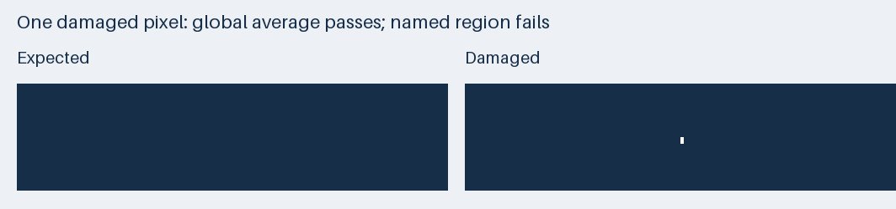

# 完成表示の比較と領域別の自動評価

`xtask quality-eval` は、名前と分類を付けた評価を JSON から読み、項目ごとの結果を保存する。
背景、保護、文字、配置、書式を別々に報告し、入力の欠損や未測定を合格と区別する。
PPTX の生成処理と PowerPoint での保存は行わない。

## 合成入力での実行

次の手順は実資料を必要としない。
Rust と既存の `uv` を使用し、Python の依存は隔離環境へ解決する。

```sh
cd macos-app
cargo build --locked -p xtask
uv run scripts/quality_eval_example.py --out ../archive/quality/eval-example
target/debug/xtask quality-eval \
  --config ../archive/quality/eval-example/passing.json \
  --report ../archive/quality/eval-example/passing-report.json
target/debug/xtask quality-eval \
  --config ../archive/quality/eval-example/failing.json \
  --report ../archive/quality/eval-example/failing-report.json
```

最初の評価は終了コード 0、最後の評価は終了コード 1 になる。
最後の入力は、暗色のフッター内の 1 画素だけを白くしたもの。
既存の全体差分の既定値では合格する小さな破損を、フッター単独の評価で検出する。
合成画像と生成コードは実資料を含まない。



## 評価設定

```json
{
  "version": 1,
  "provenance": {"input": "synthetic"},
  "checks": [
    {
      "name": "dark footer",
      "category": "background",
      "required": true,
      "page": 1,
      "region": {
        "space": "image_px",
        "canvas": [128, 96],
        "rect": [0, 80, 128, 96]
      },
      "metric": {
        "kind": "image_diff",
        "actual": "actual.png",
        "expected": "expected.png",
        "pixel_threshold": 0,
        "max_changed_pixels": 0
      }
    }
  ]
}
```

パスは設定ファイルの場所を基準に解決する。
ページ番号は 1 始まりで、矩形は `(左, 上, 右, 下)` の半開区間とする。
`image_px` の `canvas` は評価座標の基準寸法で、実画像の寸法へ倍率を掛ける。
左上は切り捨て、右下は切り上げて画素を選ぶ。
範囲外の矩形、寸法の違う画像やマスク、空の選択マスクは未測定になる。

`slide_pt` は PPTX のスライド座標で、`canvas` と実スライド寸法が一致する必要がある。
文字枠の中心が矩形に入る形状を、スライド内の順序で選ぶ。
これは文字内容と書式を選択するための条件であり、実描画の越境は `bounds` で測る。
グループ化した形状、テーマから継承する書式、フィールドなど、今回の変換出力にない形式は未測定として扱う。

| 指標 | 計測内容 | しきい値や期待値 |
| --- | --- | --- |
| `image_diff` | 画素差。任意のマスクで保護画素に限定可能 | `pixel_threshold` を超えた画素が `max_changed_pixels` 以下 |
| `luminance` | 明るい色や暗い色の混入 | `above` または `below` に該当する画素が `max_pixels` 以下 |
| `mask_overlap` | 保護マスクと消去マスクの重なり | `max_pixels` 以下 |
| `text` | OOXML の文字枠を順序付きで比較 | 大小文字、空白、アンダースコア、改行を含め `expected` と一致 |
| `runs` | OOXML の文字列ごとの字重、RGB 色、欧文と東アジアのフォント | `expected` と一致。文字サイズは配置制約による変更と分ける |
| `bounds` | PowerPoint の保存済みの実描画範囲 | 枠の横方向、スライド外、診断の許容領域への越境が `tolerance_pt` 以下 |
| `json_equal` | 保護理由など診断 JSON の値 | JSON Pointer で指定した値が `expected` と一致 |
| `unmeasured` | 測れなかった項目 | `reason` を保存し、合格件数へ加えない |

輝度は `(299R + 587G + 114B) / 1000` を切り捨てた値とする。
`above` と `below` の境界値は該当画素へ含めない。
P0 の固定領域の色数は、この資料で使った検証指標であり、任意の資料へ適用する一般的なしきい値ではない。

`bounds` は集計済みの最大値を信用せず、保存された `text_bounds` の `frame` と `ink` から再計算する。
全形状の件数とインデックスの一意性を確認し、`frame` を PPTX と 0.01 pt 以内で、診断の文字枠を PPTX と 0.001 pt 以内で照合する。
保存済み計測を使った評価は、今回 PowerPoint を再操作した計測とは区別する。
取得元ファイルとの対応は、後述のハッシュ照合でも固定する。

結果は `passed`、`failed`、`unmeasured` の 3 種類になる。
`required` の既定値は `true` で、必須項目に不合格または未測定があれば終了コード 1 を返す。
`required: false` は、既知の失敗を持つ修正前の対照や、測れない項目を記録するために使う。
これらも不合格件数と未測定件数へ含める。
分類ごとの `configured: 0` は、その分類に評価が設定されていないことを表す。

## 全ページの三者比較

`scripts/full_page_review.py` は、ハッシュを固定した元 PDF と修正前後の PPTX を描画する。
既存の LibreOffice と Poppler (`pdftoppm`) を使い、PowerPoint の保存や画像書き出しは行わない。
元 PDF は 72 DPI、PPTX から取得した PDF は 144 DPI で描画し、指定の比較寸法へ LANCZOS で拡縮する。
切り抜きと余白追加は行わず、各ページの元寸法と縦横の倍率を記録する。
200% の領域画像は最近傍補間で作る。

```sh
uv run scripts/full_page_review.py \
  --manifest ../archive/quality/full-page-review/manifest.json \
  --out ../archive/quality/full-page-review \
  --xtask target/debug/xtask
```

マニフェストの `artifacts` には `source`、`before`、`after`、`approved_baseline` のパス、SHA-256、生成コミットを設定する。
`pages`、`canvas_px`、拡大する `regions`、`evaluation_config`、制約を示す `notes` も必要になる。
`evidence` には診断や実描画範囲のファイルを列挙し、取得済みの SHA-256 で固定する。
マニフェストのパスはマニフェストの場所を基準に解決する。
評価設定の画像パス `@render/backgrounds/after-05.png` のような指定は、出力先の生成画像へ置き換える。
PPTX の背景画像は presentation の関係をたどってスライド順に取り出し、比較寸法へ拡縮する。

ツールは入力と証跡のハッシュを実行前後に照合し、欠番を検出する。
個別ページ、一覧、優先領域の原寸と 200%、評価 JSON、取得条件、閲覧用 `index.html` を出力する。
`execution.json` は描画エンジンと版、入力ハッシュ、評価設定、評価器の実行ファイルのハッシュ、画像の拡縮規則を記録する。
再実行のために、マニフェストと評価設定も成果物と一緒に保持する。

描画環境で日本語が欠落する場合は、マニフェストの任意項目 `fontconfig` に、既存フォントのディレクトリを指定した設定ファイルのパスと SHA-256 を渡せる。
子プロセスの `FONTCONFIG_FILE` と `FONTCONFIG_PATH` へ適用し、ユーザー全体の環境設定や PPTX は変更しない。
ディレクトリの `<dir>` とキャッシュ先の `<cachedir>` は [Fontconfig の設定仕様](https://fontconfig.pages.freedesktop.org/fontconfig/fontconfig-user.html) に従う。
参照するフォントファイルも `evidence` に登録すると、設定ファイルと合わせてハッシュを照合できる。
今回の macOS の描画では、この設定によって既存の Noto Sans JP が使用され、日本語の欠落を解消した。

実資料の全 14 ページの比較と評価は `archive/quality/full-page-review/` にローカル保存する。
タスク 2 の確定出力 `aca8cb9a…` を修正後、P0 前の `612f2ce5…` を修正前とする。
PPTX の描画は LibreOffice による完成表示として記載し、PowerPoint のスクリーンショットと区別する。
全ページの文字と書式は確認済みの P2 出力の維持を検証し、全語の独立した正解転記や、画像原稿の元フォント名の同定は未測定として保持する。

## 検証

```sh
cargo test --locked -p xtask
cargo fmt --all -- --check
cargo clippy --locked -p xtask --all-targets -- -D warnings
uv run --with pillow==13.0.0 python -m unittest discover -s scripts/tests -v
```

回帰テストは、局所的な 1 画素の破損、保護画素の変更、マスクの重なり、空のマスク、不正な座標、文字と字重の変化、実描画の越境、古い計測や欠測を扱う。
CLI の終了コードと、欠測時にも未測定を含むレポートが出ることを検証する。
